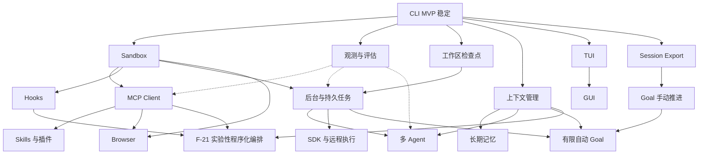

# 后续能力路线图

**更新于 2026-11-21。本文包含 F-01 至 F-21 的能力演进，已发行基础、当前实现与待开发增量分别记录。**

本文回答“CLI MVP 之后，Soyo Harness 还需要开发哪些能力”。基础扩展见[决策记录](decisions.md) D-028、D-036 至 D-038，本轮 Browser、上下文／插件细化及原生后端见 D-039 至 D-041，全局记忆编辑方向见 D-045，N6（S1／S2／S3／S5）核心契约与门禁见 D-079 至 D-082。版本候选、依赖及验收见[后续开发计划](post-mvp-plan.md)，N6 新增提案与任务规划见[N6 规划](n6-plan.md)。

0.1.0 已发布，其行为以[完整基线](mvp-baseline.md)及后续决策为准。0.2.0 已交付 N0／N1 及交互与审查修复，范围和限制保留在[版本说明](releases/release-notes-0.2.0.md)。N2 已完成原生隔离、MCP 与远程 MCP 凭据基础；N3 的上下文、选定文件检查点、本地插件／Hooks 与全局记忆也已接共享运行入口，N2／N3均完成四平台固定源码验收。N4 Goal 已完成本机受控验收；N5 Browser 已交付定制捕获引擎、专用 VM 与原生 worker 链路并完成本机／VM／Linux ARM64 及 `5fff1c4` 四平台远端终验（非 ARM64 定制引擎分发待补齐）。N6（`DEV-090` 至 `DEV-096`，涵盖 S2 延迟发现、S3 Goal 步骤验证、S5 调用样例与 S1 只读 JS REPL `F-21`）、`F-09`/`F-16`/`F-17` 及本批 `F-02`/`F-03`/`F-04`/`F-15` 增量已完成实现并记录在本机／CI 验收记录中（`windows` 沙箱与非 ARM64 定制 Chromium 分发仍为显式未覆盖边界）。[N2 验收](n2-validation.md)、[N3 验收](n3-validation.md#四平台最终验收)、[N4 验收](n4-validation.md)、[N5 验收](n5-validation.md)、[N6 验收](n6-validation.md)

P0 至 P7、DEV-001 至 DEV-037 见[MVP 实施任务](implementation-plan.md)，新增 DEV-038 至 DEV-096 见后续开发计划。

## 总体顺序

| 批次 | 目标 | 主要能力 |
| --- | --- | --- |
| 0.2.0 已交付 | 共享基础和默认 TUI | 五级日志、Session Snapshot／Export、共享应用层和 TUI |
| A：隔离与扩展基础 | 能约束实际执行，并接入外部能力 | N2 已完成 Sandbox、MCP Client 与所需凭据基础及四平台验收，N3 已接入 Skills／本地插件与 Hooks，统一身份扩展后续推进 |
| B：持续完成项目 | 能处理长上下文、多步骤和可恢复工作 | 工作区检查点、上下文管理、后台任务、联网读取、模型路由、项目索引／LSP |
| C：协作与丰富输入 | 能积累知识、分工并处理更多内容 | 长期记忆、多 Agent、多模态；浏览器交互按需求进入 |
| D：开放与部署 | 能被其他程序使用并扩展运行环境 | 稳定 SDK、本地服务／远程执行、更多平台与分发 |
| 界面演进线 | 提供更直观的交互 | CLI 稳定后推进 TUI，再做 GUI；逐步承接新增能力 |

批次表达优先级，不要求整批全部完成后才开始下一批。以依赖与单项交付为准；运行时能力无需等 GUI 完成，界面也无需等待所有扩展能力。

下图表示主要依赖，完整范围与依赖见能力总表。

## 能力总表

依赖栏中的 F 编号表示相应能力的接口或交付基础，具体增量可以先用替身验证。MVP 已有日志、运行内后台任务和 Skill 元数据发现，下面列出各模块的扩展范围，实际状态见开发进度。

| 编号 | 能力 | 优先级 | 主要依赖 | 用户得到什么 |
| --- | --- | --- | --- | --- |
| F-01 | Sandbox 执行隔离 | 最先 | MVP 工具与权限 | 对进程的实际文件、网络和资源访问形成约束 |
| F-02 | MCP Client | 最先（已扩展 Resources/Prompts/订阅/Elicitation） | MVP 工具接口；本地隔离依赖 F-01，远程凭据管理依赖 F-18 | 接入已有工具服务、Resources/Templates/Prompts/订阅与失败关闭 Elicitation，不逐个编写专用集成 |
| F-03 | Skills 与插件包 | 高（已扩展归档/验签/HTTPS） | MVP 指令加载；可执行扩展依赖 F-01、F-02 | 安装、校验（SHA-256／Ed25519／HTTPS）、启停和复用领域能力 |
| F-04 | Hooks 与自动化规则 | 高（已扩展 8 事件与 `[hooks]`） | F-01、F-12 | 在运行／模型／工具／澄清／压缩事件前后执行受控检查和动作 |
| F-05 | 工作区隔离、Diff 与检查点 | 高（已扩展 CLI/TUI 用户层与 opt-in 自动检查点） | MVP 文件与执行记录 | 查看、比较和恢复受控文件改动 |
| F-06 | 上下文管理 | 高 | MVP 协议状态、F-12 | 长任务继续工作，控制上下文占用 |
| F-07 | 全局／项目记忆与模型编辑 | 中（已扩展事实 TTL 与检索增强） | F-06、F-12 | 通过可读MEMORY.md、专用工具和审阅恢复机制维护跨会话知识 |
| F-08 | 后台与持久任务 | 高（已实现跨运行持久队列 opt-in） | F-01、F-05、F-12 | 运行长任务、暂停、继续和管理任务队列 |
| F-09 | 多 Agent 协作 | 中 | F-01、F-05、F-06、F-08、F-12 | 将任务交给有独立上下文与预算的子 Agent |
| F-10 | 联网读取与浏览器 | 中（基线链路已交付，VM opt-in 增量已实现） | F-01、F-02 | 获取网页资料，随后扩展到受控网页操作 |
| F-11 | 多模态与附件 | 中（已实现 File artifact 文本提取 opt-in） | F-01、F-06 | 使用图片、PDF 和其他附件完成任务 |
| F-12 | 日志、追踪、回放与评估 | 近期及贯穿各批次 | MVP 事件与安全日志 | 五级诊断、关联追踪、失败定位与版本评估 |
| F-13 | 稳定 SDK、服务与远程执行 | 后期 | F-01、F-02、F-08、F-12 | 将 Soyo 嵌入其他产品，管理远端任务 |
| F-14 | 默认 TUI 与桌面端 GUI | TUI 已交付；GUI（`soyo-desktop`）已按 D-072 完成本机实现与检查（多平台发行包待 CI 验证） | 共享应用服务与事件；导出依赖 F-19 | TUI 提供全屏终端交互；`soyo-desktop` 提供独立安装的 Tauri 2 桌面端界面 |
| F-15 | 平台与分发完善 | 后期（已交付 `soyo doctor`；Windows 阻塞） | F-01、F-14 | 四平台非 Windows 目标安装与自检，明确支持矩阵与阻断诊断 |
| F-16 | 模型路由与故障切换 | 中 | F-06、F-12、F-18 | 按能力、预算和可用性选择已配置模型 |
| F-17 | 项目索引与 LSP 代码智能 | 高 | F-01、F-06 | 基于符号、引用和诊断理解代码，减少全文扫描 |
| F-18 | 统一凭据与身份管理 | 高，配套第一批 | 统一后端（`file`/`system`）+ 受控注入已交付 | 管理服务凭据、授权范围、续期与撤销 |
| F-19 | Session Export | 近期 | MVP SQLite、只读一致性快照与脱敏 | 导出 Markdown／JSON 对话与可选工具、运行数据 |
| F-20 | Goal 目标编排 | 分阶段 | 手动阶段依赖应用／存储；自动阶段依赖 F-01、F-05、F-06、F-08、F-12 | 定义目标与证据，手动推进后扩展有限自动续跑 |
| F-21 | 实验性程序化工具编排（只读 Code Mode 风格 REPL） | 已实现（默认关闭，D-083/D-084） | F-01、F-02、F-04、F-06 | 在默认关闭的 opt-in 下，由沙箱内只读 QuickJS/Node 脚本编排多步只读工具并仅回传过滤结果，每次底层调用仍走既有权限与 Hooks |

## F-01 Sandbox 执行隔离

**价值**：权限系统决定操作是否获准，sandbox 约束获准操作实际能够访问的资源。

N2 已实现以下范围，平台保证以实际验收证据为准。

- 建立可替换执行后端，支持宿主测试后端与真正隔离的后端，明确展示当前后端和能力。
- 文件系统：工作区／临时目录、只读与可写挂载、宿主目录隔离、产物取回。
- 网络通过禁网策略及受控 HTTP／CONNECT broker，逐连接核对精确 origin、DNS 与固定目标地址。
- 进程与资源包含所属进程清理、运行时间、可选单进程限制、显式委派 cgroup v2 聚合限制，以及环境和凭据注入范围。
- 支持能力探测；用户选择的隔离要求无法满足时明确失败，不静默换成无隔离宿主执行。

当前默认按平台选择原生后端。Linux 使用 Bubblewrap + Seccomp + socat，macOS 将 sandbox-exec 封装为独立 SeatbeltBackend，统一接口预留容器／VM 的后续实现。资源能力区分 hard／best_effort／unsupported，macOS 后代清理为 best_effort。命令 AST／CST 风险事实、文件策略、资源及性能验收见[Sandbox 实现边界](sandbox.md)。

验收要求子进程遵守已声明的隔离边界，资源和清理结果符合能力等级，所报告后端与实际运行一致。工作模式、权限模式与后端选择分别生效，bypass 保留所选环境的硬边界，PLAN 继续禁用通用 exec。四平台原生验收与实际能力证据见[N2 验收](n2-validation.md)。

## F-02 MCP Client

**价值**：让 Soyo 作为 MCP 客户端／宿主，使用外部工具，而不是让用户为每种服务编写 Soyo 专用工具。

当前实现与后续增量如下。

1. 已实现本地 stdio 的显式配置、受控启动与关闭、能力协商、工具发现和调用。
2. 已实现远程 Streamable HTTP、OAuth 发现与登录、令牌续期／撤销、取消与有界错误处理。
3. **本批已扩展（D-089）**：已接入 MCP Resources（列出、分页与读取）、Resource Templates、Prompts（列出、参数校验与读取）、协议版本协商订阅（`2025-11-25` `resources/subscribe` 与 `2026-07-28` `subscriptions/listen`）及通知目录失效；新增仅在连接服务通告对应能力时动态注册的只读宿主工具 `mcp_list_resources`、`mcp_read_resource`、`mcp_subscribe_resource`、`mcp_list_prompts`、`mcp_get_prompt`，以及 `ClientHandler::create_elicitation`（无交互处理器时默认 `Decline` 失败关闭）；MCP Tasks（长异步任务）继续按后续需求扩展。
4. **N6 已实现（`D-079`/`D-081`）**：S2（`DEV-090`）在已发现 MCP 工具总数超过阈值（默认 `> 8`）时自动启用延迟加载，提供 `tool_search`／`tool_describe` 按需展开并保持首部缓存前缀逐字节稳定；S5（`DEV-093`）新增 `ToolDefinition.examples` 及 `jsonschema`/脱敏校验。详见[N6 规划](n6-plan.md)与[N6 验收](n6-validation.md)。

服务器管理、稳定工具命名、schema 校验、输出大小／内容类型、权限判断、执行记录、取消及非交互终止已接入共享运行时。本地 MCP 服务启动和生命周期使用执行后端与独立启动授权，HTTP 服务由宿主管理，具体配置与限制见[MCP 与凭据](mcp.md)。

当前固定官方 Rust SDK [rmcp](https://github.com/modelcontextprotocol/rust-sdk) 3.9.0，首选协议 2026-07-28，兼容 2025-11-25。实现依据包含 [stdio／Streamable HTTP](https://modelcontextprotocol.io/specification/2026-07-28/basic/transports)、[HTTP 授权](https://modelcontextprotocol.io/specification/2026-07-28/basic/authorization)与[工具规范](https://modelcontextprotocol.io/specification/2026-07-28/server/tools)，实际协议矩阵与四平台验收证据见[N2 验收](n2-validation.md)。

验收：至少一个本地和一个远程测试服务器完成发现、调用、拒绝、取消与失败路径；同名工具不会冲突，外部工具不会绕开 Soyo 的权限。服务器工具 annotations 只作为声明性信息，不能单凭只读提示获得更高权限；这也符合工具规范对不可信 annotations 的要求。

Soyo 自身对外提供 MCP Server 放在 F-13 的集成方向中，不与首轮 MCP Client 混成一个交付项。

## F-03 Skills 与插件包（soyo-plugin）

插件系统命名为 `soyo-plugin`。D-033 的目录发现基础已扩展为 Skill 按需激活及资源读取，本地目录插件支持校验、安装、启停、更新、卸载和恢复，MCP／Hook 入口通过当前权限与原生后端执行。N3 固定候选已完成四平台联合验收；**本批已扩展（D-090）**支持 `.tar`／`.tar.gz`／`.tgz` 归档内存受限校验（拒绝链接／穿越并复用 `FileBudget`）、`--sha256` 与 `--pubkey`＋`--signature`（Ed25519）校验，以及经公网 IP DNS 固定、禁系统代理与手动重定向约束的 `--url <HTTPS_URL>` 拉取；第三方公共注册中心／自动依赖下载留待生态阶段。[soyo-plugin 规范](soyo-plugin.md)、[N3 验收](n3-validation.md#四平台最终验收)

**价值**：将领域指令、工作流、工具连接与资源打包复用。

- Skills：显式启用的技能目录、元数据、按需加载的指令与引用资源、用户级／项目级作用域。
- 插件包：manifest、版本、依赖与能力声明，包含 Skills、MCP 配置、资源和可选 Hooks。
- 管理：从明确来源安装、列出、启停、更新和卸载，展示更新差异与来源；不自动执行安装包声明的任意脚本。
- 权限：加载指令不等于授予工具权限，项目包不能提升宿主策略；可执行部分通过受控进程／MCP 接入。

当前采用声明式包、本地安装与受控进程边界，分发索引、签名和生态管理后续推进。

验收：一个领域技能与一个包含 MCP 配置的插件能安装／启停／升级，来源与依赖可查，停用后不继续注入指令或启动进程。

## F-04 Hooks 与自动化规则

**价值**：在固定事件点执行格式化、验证、通知或组织级规则。

N3 已接入 `run.started`、`run.finished`、`tool.before_dispatch`、`tool.finished` 四个事件及 observer／check、持久意图和有界执行，固定候选已完成四平台验收。**本批已扩展（D-088）**：新增 `model.before_request`、`model.finished`、`input.required`、`compaction.finished` 四项事件（其中 `tool.before_dispatch` 与 `model.before_request` 支持 `check`），并新增默认关闭的宿主配置 `[hooks]`（`[[hooks.rules]]`，含 `tools`／`modes` 过滤），统一经 `PreparedEnvironment` 与 `HookJournal` 执行。[当前 Hook 契约](soyo-plugin.md#可执行入口和-hooks)

- 定义运行开始／结束、模型返回、工具执行前后、需要人工输入等事件。
- 区分观察型 Hook 与可阻止操作的检查型 Hook，明确失败、超时和输出格式。
- Hook 具有来源、执行环境、预算和日志；调用脚本同样进入 sandbox／权限处理。
- 支持用户配置事件与动作关联，防止递归触发和恢复后重复执行。
- Hook 可以提出拒绝或建议，不凭返回文本自动授予原本缺失的许可。

验收：格式化／检查示例正常工作；超时和拒绝可定位，Hook 不绕过执行记录，不造成事件递归。

## F-05 工作区隔离、Diff 与检查点

**价值**：用户能看清 Agent 做了什么，并对受控文件改动进行比较和恢复。

N3 已接入选定文本文件的快照、列表、Diff、接受和恢复，普通目录与 Git 目录复用相同文件版本及冲突检查。独立 worktree 和更广的工作区隔离继续按后续增量推进。[N3 验收](n3-validation.md)

> **实现状态（D-095）**：检查点引擎此前仅经五个模型工具暴露。本批补齐用户侧表面：`soyo-app` 新增 `checkpoint_admin` 服务（复用同一 `CheckpointStore`，按 `--session` 或当前工作区最新会话绑定单一 `session_id`）；CLI `soyo checkpoint` 子命令组提供 `list`/`diff`/`create`/`accept`/`restore`/`recover`，restore 在无 TTY 时需 `--yes`、有 TTY 时逐文件确认 unified diff，且镜像运行时的 `restore_target`/`resolve_future`/`protected_overlap` 允许写根检查；TUI `/checkpoint`（`/checkpoints`）复用 memory 管理面板的模态/确认模式，`confirm OP_ID` 二次确认；会话恢复接入 `CheckpointWorkspace::recover`，被中断的多文件 restore 把 Unknown 结果随 `RecoverySummary.checkpoint_journals` 上浮；新增 opt-in `[checkpoint] auto_capture`（默认关），在 `write_file`/`edit_file`/`apply_patch` 授权后捕获其将触碰的精确路径，失败不阻塞工具。PLAN 只读；restore 在 PLAN/read_only/空写根下仍被抑制。helper IPC 与桌面端 `checkpoint_*` 未接入，Git worktree 隔离仍在后续增量。

- Git 项目可使用独立 worktree；非 Git 工作区使用受控目录与文件快照策略。
- 在阶段或修改前建立检查点，展示增删改与可追溯产物；支持选择文件接受或恢复。
- 检测外部修改和合并冲突，恢复前检查当前文件版本，保护用户后续工作。
- 区分文件恢复与外部副作用：发出的请求、数据库变更等不能假装被文件回滚撤销。

验收：跨多轮任务可比较和恢复选定文件，既有用户修改保持可追踪，冲突不被静默覆盖。

## F-06 上下文管理

ContextBuilder、OutputStore、引用检索和自动／手动 Compact 已接入共享运行入口，包含预算、协议分组、80%／55%水位、来源检查点及缓存边界。DEV-062／063／076／077 已完成四平台固定候选验收。下列范围中的附件和跨模型／协议迁移按各自后续任务推进。[上下文与长输出](context-management.md)、[N3 验收](n3-validation.md#四平台最终验收)

**价值**：长任务在预算内继续执行，用户能理解摘要和检索对上下文的影响。

- 上下文组成与占用可见：任务、指令、工具结果、附件、摘要与最近对话。
- 显式压缩与可配置自动压缩，保留核心约束、当前目标、未完成工具关联和必要协议状态。
- 对大工具输出做分页、引用与按需检索；原始记录保留，摘要能追溯到来源。
- 评估压缩前后是否丢失约束或关键事实；跨模型／协议迁移单列兼容能力，不随摘要功能默认开启。

验收：超长任务继续完成，预算与摘要来源可见，权限和 PLAN 约束不因压缩丢失。该能力属于后续版本对 MVP“不自动摘要”行为的明确扩展。

## F-07 全局／项目记忆与模型编辑

**价值**：跨会话复用项目知识，同时让用户能够查看和纠正记忆。

N3 已实现 `~/.soyo/MEMORY.md` 与主题资料目录，提供默认读取／注入、五个模型工具、来源及workspace作用域、更正／遗忘、原子发布、历史回滚和 CLI／TUI 管理。DEV-084至DEV-089 已通过固定源码的四平台验收。**本批已扩展（D-092）**：`MemoryFact` 新增可选 `expires_at`（`unix:<secs>`，`skip_serializing_if` 保持向后兼容），到期事实在 `active_document` 统一过滤并从快照／读取／检索／投影中一致消失；`memory_update` 工具新增 `expires_in_seconds`（1 秒至 5 年），`[memory] default_fact_ttl_seconds` 提供默认 TTL；检索评分加入整词命中加权、全 term 覆盖加成与事实类型加权（`ExplicitPreference`/`UserCorrection`/`TaskDecision`）。语义检索与更广的知识管理按后续需求扩展。[全局记忆](memory.md)、[N3 验收](n3-validation.md#四平台最终验收)

- 区分会话历史、项目记忆和用户级偏好，不把保存所有日志当作记忆系统。
- 支持记住、查看、编辑、删除和过期；每条知识带来源、作用域和更新时间。
- 先做可解释的文本检索，再按效果引入语义检索；不预先锁定向量数据库。
- 检索结果以带来源的数据加入上下文，不提升指令优先级或越过项目作用域。

验收：能命中并引用相关记忆，用户更正或删除后结果相应变化，不在无关项目自动使用受限内容。

## F-08 后台与持久任务

**价值**：将一次前台循环扩展成可以管理的长任务。D-029 已将不跨运行的后台工具纳入 MVP；下述跨运行持久队列和调度仍属于后续能力。

> **实现状态（D-093）**：跨运行持久任务队列已按默认关闭（`[tasks] enabled = false`）实现：`TaskStore`（`<data_dir>/tasks/tasks.sqlite3`，0700／0600、`APPLICATION_ID 0x5354_5131`、WAL、`synchronous=FULL`、无 `workspace_leases`）与 `task_leases`＋`task_dispatches`（`(task_id, attempt)` 主键，intent→running→completed/failed/unknown）三表；`begin_attempt` 在单事务内完成租约检查＋`queued→running`＋dispatch intent 落库，崩溃后 `recover_unknown` 将到期在飞 dispatch 标记为 `waiting_unknown` 并**绝不自动重放**——只有显式 `resolve`（`retry` 重新排队或 `blocked` 挂起）或 `transition` 才能继续。每次 attempt 复用同一 `Session`，一次只驱动一个 `Run`（`run_task_once`，与 Goal `continue_once` 同型：lease 心跳、pause/cancel 控制轮询、结果按 `persistence_saved` 映射 `completed`/`failed`/`waiting_unknown`）。CLI `soyo task submit|list|status|pause|resume|cancel|resolve|continue|recover`、TUI `/task`（submit/status/continue/pause/resume/cancel/resolve/recover）与 helper RPC（`task_list`/`task_jobs`/`task_status`/`task_submit`/`task_pause`/`task_resume`/`task_cancel`/`task_resolve`/`task_recover`/`task_continue`）三端接入，桌面端经 Tauri commands 暴露同一组方法。[使用指南](usage.md)、[配置](configuration.md)。

- 持久任务队列、后台 worker、任务状态与产物，支持提交、查看、取消、暂停和显式继续。
- 明确“恢复上下文”“继续未完成步骤”“重试已执行操作”的差别，结合执行意图／结果和幂等设计。
- 支持分步工作流、超时、预算与失败后人工介入，再增加手动触发、定时或事件触发。
- 记录触发来源、时区、执行身份与权限；任务不能自行从前台变成无限后台循环。

验收：重启后能查看并按规则继续，结果不明的外部副作用不自动重放；取消能结束对应进程与资源。

## F-09 多 Agent 协作

**价值**：将大任务分成可独立执行和核验的子任务。

> **实现状态（D-085）**：单层受控父子委派（`max_depth = 1`）已按默认关闭（`[subagents] enabled = false`）实现，涵盖 7 个 `subagent_*` 工具、非提权规则与 `PLAN` 切态取消、Git Worktree / 有界目录拷贝隔离、三方 SHA-256 冲突检测合并、共享预算与单源 Metrics 汇总、取消清理、Goal 配置指纹及 CLI／TUI／桌面端呈现（`Settings › Experimental`）。多层递归委派、跨运行持久子 Agent 与远程协同仍属后续扩展。详见[受控子 Agent](subagents.md)与[F-09 说明](releases/release-notes-f09.md)。

- 父子任务、分工、消息、结果汇总、独立上下文与预算；对子任务数量和并发设上限。
- 子 Agent 的权限、网络、凭据与可访问文件不能自动高于父任务的授权范围。
- 独立 worktree／sandbox 与合并流程，避免多个 Agent 同时覆盖同一文件。
- 取消、失败、超时和资源预算向子任务传递，汇总结果仍需实际验证。

先做受控父子任务，再考虑多层委派与更复杂协作。验收包含两个独立改动的隔离、冲突处理、总预算与取消；子任务需要有可核验的产物与合并结果。

## F-10 联网读取与浏览器

BrowserProvider 首版候选为托管 Chromium／Playwright MCP worker，通过原生后端约束。URL／搜索、ARIA 快照、页面交互、截图、文件、登录、后台任务及策略见[Browser 设计](browser.md)，任务为 DEV-079 至 DEV-083。

> **实现状态（D-096／D-098／D-099）**：基线 Browser 链路（DEV-079 至 DEV-083、专用 Colima VM＋原生 worker、schema v2 安装树身份、`[browser.network]` broker 唯一出口）已交付并完成四平台固定源码终验。本批新增**四个默认关闭、互不耦合的 VM 后端 opt-in 增量**，全部失败关闭、关闭时零漂移：(1) `[browser.profile]` 持久登录／profile 状态——按名字管理的 `userDataDir`＋保留期限，刻意放宽 per-Run scratch 保证，是新增的 opt-in 安全／外泄面（D-098），持久上下文禁用私有 isolated-stdio 通道故截图 facts 失败关闭；(2) `[browser.remote]` 远程／CDP attach——worker 仍跑在 VM 内经身份验证，仅被驱动的浏览器换成显式 CDP 端点；私有 `processInfo`＋`captureScreenshot` 通道不可满足故**全部四项 facts 失败关闭**（D-096），endpoint 须为 VM 回环字面量且有精确匹配的 dev_service 转发；(3) `[browser.dev_service]` localhost 开发服务转发——每条 `alias`＋回环字面 host＋精确端口经 SSH 反向 streamlocal＋netns socat 桥接，精确端点、绝无通配；(4) 非 ARM64 遮蔽截图引擎分发姿态——`MASKED_CAPTURE_ENGINE_TARGETS` 显式集合只含 `aarch64-unknown-linux-gnu`，`linux-x86_64` 为下一目标（真实 patched 构建仍待产出）、macOS 双架构不支持（引擎是 Linux ELF），非列出目标绝不 provisioning 也绝不声称截图能力（D-099）。四者均要求 `[browser.vm]`，与原生 worker 互斥。

**价值**：完成需要外部资料与网页交互的通用任务。

- 先实现搜索／URL 读取、来源引用、下载大小与类型限制、超时和内容提取，可先通过 MCP 服务验证实际需求。
- 网络访问与凭据归属可配置；网页内容作为工具数据，不作为能修改权限的指令。
- 后续再做隔离浏览器环境、页面操作、截图与下载，明确需要用户介入的认证与外部修改。
- 浏览器状态和文件产物进入任务记录，断连或恢复不自动重复提交操作。

验收：来源可追溯、网络策略生效、动态网页失败可理解，涉及实际网页修改时有对应许可与执行证据。

## F-11 多模态与附件

**价值**：在文本之外使用图片、PDF 等输入完成真实工作。

- 附件的导入、引用、大小／类型检查、存储与生命周期，避免把所有文件直接拼进文本。
- 先做图片与 PDF，按需求增加音频、视频及其他文档解析。
- 按模型 profile 的实际能力适配内容，无法处理时明确说明，不静默遗漏附件。
- 文档解析过程进入受控环境，提取内容有来源、页码或时间位置，计入上下文预算。

验收：至少一个图片任务和一个多页文档任务完整往返，引用定位正确，恢复后附件关联保持有效。

> **实现状态（D-094）**：File artifact 文本提取已按默认关闭（`[file_text] enabled = false`）实现。宿主在装载模型请求媒体投影（`media::load_history`）时，把 `ToolResult.media_refs` 引用的 File artifact 提取为有界 TEXT 内容——附带 `name`/`ref`/`mime`/`sha256`/`pages` 的引用信封、计入上下文预算、按内容摘要缓存于 `cache_dir/file_text/`（0700 私有目录、0600 `O_NOFOLLOW`）。File artifact 本身仍不进入模型媒体内容（`ensure_supported(File)` 保持 false），提取文本经各 provider 适配器以邻接 user 文本块发送、按 reference 去重。转换优先用沙箱化的外部 `markitdown`（专用原生环境：网络拒绝、只读安装前缀、最小 `PATH`/`TMPDIR`，sandbox 准备失败按 D-050 明确失败、不回退未隔离执行），不可用时回退纯 Rust 有界 PDF 提取（`--- page N ---` 标记，图片型／非 PDF 返回 `file_text_unavailable` 静默省略）。`converter = auto|markitdown|builtin`、`max_text_bytes`/`max_files_per_message`/`timeout_seconds`/`cache_max_bytes` 均有界可配。[配置](configuration.md)。

## F-12 观测、回放与评估

DEV-040 至 DEV-042 已实现五级日志、tracing span、`--log-level`、本地查询与跟随，并通过本机验收。历史回放与评估仍按本能力的后续范围推进，细节见[日志与追踪](observability.md)。

**价值**：持续回答“为什么失败”“改版是否更好”“消耗发生在哪里”。

- 模型、核查、工具、权限、sandbox、MCP 与 Hook 的关联 trace 和执行时间线。
- 不执行副作用的历史回放、输入输出检索、失败定位、用量与费用归因。
- 固定任务集、协议夹具、权限／恢复回归和模型质量评估；版本之间可比较。
- 事件／报告导出可配置，保留脱敏与用户控制；不因增加观测功能自动上传遥测。

该能力从第一批持续建设。验收以可复现的失败定位、无副作用回放及版本回归报告为准，不用单一成功率掩盖权限或数据一致性问题。

## F-13 稳定 SDK、服务与远程执行

**价值**：让其他程序能够使用 Soyo，并将执行位置从当前终端扩展出去。

- 先收敛嵌入式 SDK 的运行、控制、事件、错误与兼容策略，区别于 MVP 开发期可调整的内部 Rust API。
- 再做本地服务与任务查询，支持客户端断开后可理解的任务生命周期。
- 按需求增加远程 worker、工作区／产物同步、执行身份、凭据与配额隔离。
- Soyo 作为 MCP Server 对外提供任务能力属于这一层的可选入口，不能通过暴露接口绕开原权限与 sandbox。

验收：一个外部程序能通过 SDK／服务执行和取消任务，断连、重连及远端失败不会丢失状态或重复副作用。

## F-14 TUI 与 GUI

0.2.0 已交付默认 TUI，无子命令的 `soyo` 在 stdin／stdout 均连接终端时进入全屏界面，文本交互使用 `soyo chat`。N0 已建立共享 soyo-app 与有界事件／交互桥，N1 已接入 soyo-tui、TTY 路由和终端恢复。当前 N2 增加真实 MCP 生命周期与工具数展示，各轮交互增量按源码记录验证，见[TUI 文档](tui.md)和[开发进度](progress.md)。

GUI 方向已于 D-072 确认为 Tauri 2 + in-process 桌面端 `soyo-desktop`（`desktop/` 与 `desktop/src-tauri`，React + Vite + TypeScript + `lucide-react`，Windows NSIS／Linux AppImage／macOS `.dmg` 与 `.app.tar.gz` + Ed25519 Updater 分发），目前已完成工作区骨架、schema v1 Channel 流式对话与取消、审批／澄清往返、模式与权限切换、会话恢复、外围管理（设置／模块开关／脱敏 MCP 与凭据／两阶段全局记忆／会话导出／受限 `soyo-attachment://` 协议）、更新提示条及 `desktop-release.yml` 打包工作流并通过本机检查，见[桌面端设计](desktop.md)。桌面端的实际本机验证与尚未运行的远端多平台打包／签名公证边界独立记录于[开发进度](progress.md)，不复用 TUI 的四平台候选验收结果。

**价值**：让已形成的运行时能力有清楚的交互入口。

- TUI：会话／任务、流式对话、工具调用、模式、确认／澄清、检查点与后台状态。
- GUI（`soyo-desktop`）：在进程内复用 `soyo-app`／`soyo-core` 与 schema v1 事件契约，提供会话管理、流式 Markdown 对话、工具卡片、工作／权限模式切换、审批／澄清往返、设置、模块开关、脱敏 MCP／凭据管理、全局记忆、会话导出与受限 `soyo-attachment://` 附件预览。
- 界面通过同一核心命令／事件／控制接口工作；增加面板不复制一套权限或执行循环。
- 新能力按可用性逐步进入界面，不要求先实现所有扩展才能交付。

验收复用核心行为与权限用例，并覆盖交互、退出清理、可访问性、安全边界（CSP／脱敏／协议作用域）与恢复。TUI 与桌面端的平台验收分别追踪。

## F-15 平台与分发完善

**已实现局部（D-091）＋显式阻塞边界**：已交付离线诊断命令 `soyo doctor [--strict]`（检测原生沙箱可用性、`config.toml`/profile、`.soyo`/`.saya` 私有目录权限与 `git`／`js_repl`／LSP 等可选工具，输出结构化平台支持矩阵并全程脱敏）；桌面端与 CLI CI 覆盖 `macos-15`/`macos-15-intel`/`ubuntu-22.04`/`ubuntu-22.04-arm`。**未实现阻塞**：`windows` 目标因原生 AppContainer／Job 沙箱及私有存储 DACL 未实现仍显式标为 `unsupported`（不以“能编译”冒充支持）；定制遮蔽 `headless_shell` 产物仅验证 `linux-arm64`，其余架构构建分发仍待外部产物。

**价值**：让开发者在更多环境中可靠安装、更新和运行。

- 先维护已确认 macOS／Linux 目标，完善安装、签名／校验、依赖诊断与升级迁移。
- 按需求增加 Windows、其他 Linux 发行环境与架构，分别验证命令、锁、信号、sandbox 和路径语义。
- 将平台能力差异做成明确的支持矩阵，不用“能编译”代替隔离与恢复功能支持。

验收以干净环境安装、升级、回退和平台测试为准；新系统支持不改变 0.1 的已有目标定义。

## F-16 模型路由与故障切换

**已实现状态（D-086）**：已在 `soyo-contract`/`soyo-core`/`soyo-app`/`soyo-cli`/`soyo-tui`/`soyo-ipc`/`soyo-host`/`desktop` 完成默认关闭（`[routing].enabled = false`）实现，包含 `[profiles.<name>.capabilities]`、角色／模式路由、`prefer_lowest_cost`/`max_run_cost_microunits` 预算筛选、`!received && is_transient_model_error()` 预流故障切换与熔断、`OpaqueHistoryPolicy`（`reject`/`migrate_compatible`/`require_new_session`）、`ModelRouted` 与 `RunMetrics` 分 profile 归因、`soyo routing explain` / `--migrate-history` 与桌面端开关，详情见[模型路由设计](model-routing.md)。

**价值**：在多个已配置模型之间管理能力、可用性与消耗，不把所有任务固定到同一配置。

- 按任务类型、工具／多模态能力、上下文需求与预算选择候选 profile，提供显式路由与可解释的选择记录。
- 区分执行、规划与核查角色的模型配置；记录实际服务、模型、请求与成本归属。
- 健康状态、限流和暂时错误可触发已配置的回退策略，不自动选择未知账号或额外付费服务。
- 模型回退不能导致工具副作用重放。含不透明协议状态时，明确选择兼容迁移或新建会话，不能只替换模型名称。

验收：能力不匹配被排除、回退有记录、总预算仍生效，不能迁移的历史得到明确处理。MVP 仍保留不自动回退、不在同一会话切换模型／协议的基线，本能力在后续版本单独扩展。

## F-17 项目索引与 LSP 代码智能

**已实现状态（D-087）**：已在 `soyo-core`/`soyo-app`/`soyo-cli`/`soyo-tui`/`soyo-ipc`/`soyo-host`/`desktop` 完成默认关闭（`[code_intel].enabled = false`、`[code_intel.lsp].enabled = false`）实现，包含工作区外 SQLite 符号索引（`0700`/`0600`、`.gitignore`/`.git`/私有路径与符号链接防御、`(size, mtime_ns, sha256)` 增量更新）、`PreparedEnvironment` 只读工作区沙箱 LSP 3.17 客户端、6 个只读 `code_*` 工具（含 `diffy` + `STALE_INDEX` 预览）、`soyo_code_intel_v1` 低信任导航注入、`soyo index build|query|status` 与桌面端开关，详情见[项目索引与代码智能](code-intelligence.md)。

**价值**：为 CODE／BUILD 提供项目结构和语言语义，减少反复全文搜索和不准确的代码定位。

- 文件／符号索引、增量更新与失效机制，遵守工作区范围、忽略规则和版本信息。
- 接入语言服务器以提供定义、引用、工作区符号和诊断；协议入口参考 [LSP 官方项目](https://github.com/microsoft/language-server-protocol)，实施时再验证所用语言服务器与协议能力。
- 语言服务器的进程、索引缓存和资源消耗纳入执行环境；查询结果带文件与位置来源。
- 将检索结果按需注入上下文；语言服务器给出的编辑建议仍通过文件版本检查与权限处理。

验收：至少一个 Rust 项目能完成定义／引用／诊断查询，文件修改后索引及时更新；过期索引不静默覆盖当前文件，PLAN 的缓存仍保存在目标工作区外。

## F-18 统一凭据与身份管理

**价值**：为模型、MCP、插件与远程任务提供一致的凭据生命周期和作用域。

N2 已实现远程 MCP 所需子集，包括私有文件存储、环境变量导入、OAuth 登录、作用域绑定引用、刷新与永久撤销。首个存储后端为 0700／0600 私有明文文件，动态已知凭据集合接入模型、持久化、事件与界面边界。管理入口与本机、四平台联合验收已通过。

> **实现状态（D-097）**：Batch 3 收尾补上了统一凭据层：`CredentialStore` 把元数据索引（仍走 0700 私有文件索引、保持 `file` 后端零漂移）与 material 后端分离，`[credentials] backend` 显式选择 `file`（默认）或 `system`；`system` 目前实现 macOS Keychain（`security-framework`），其余平台返回 `credential_backend_unavailable`、绝不静默回退到明文。`CredentialGrant`（绑定 `CredentialRef` + 工作区身份 + run kind + 工具名集合 + 过期时间）与 URL 绑定的 `CredentialScope` 分治——`env_credential_refs` 的 stdio MCP 注入必须同时通过 scope 匹配与 grant 门（`resolve_granted`），绝不把整套宿主凭据交给子进程。`soyo credentials list|import|revoke|rotate|grant|grant-revoke|grant-list|login` 统一管理、不再要求启用的 MCP server；`rotate` 对 secret 类凭据原地换值并 `revision` 自增（OAuth 经刷新/重新登录轮换），`import`/`revoke`/`login`/`grant` 写脱敏 `credential.event` 审计行。模型 profile 的 `api_key_ref` 也走 `credential_ref` 间接层。[MCP 与凭据管理](mcp.md)

- 在 MVP 的环境变量引用之上增加系统凭据存储或受支持的安全后端，配置与会话只保存引用。
- 管理 OAuth 登录、令牌续期、清除／撤销与账号切换；显示凭据用途和授权范围。
- 按服务、项目、工具与任务限定可用凭据，向 sandbox／子任务进行受控注入，不把全部宿主凭据交给每个进程。
- 保持模型上下文、核查输入、日志、导出和执行记录的已知凭据脱敏；凭据后端不可用时明确报错。

验收：权限范围、轮换与撤销即时反映到后续调用，恢复会话不恢复旧许可，测试凭据不出现在上下文、日志与数据库中。后端和保存格式在对应设计中验证，不改变 MVP 仅引用环境变量的默认行为。

## F-19 Session Export

DEV-043 至 DEV-046 已实现并通过本机离线验收。

从一致性快照生成 Markdown 和版本化 JSON，支持 transcript／full 范围及显式工具正文选择。导出文件路径使用 `--file`，命令 stdout 继续使用全局 `--output` 选择表达。

导出保留消息顺序、Run／调用关联、水位与 unknown 状态，应用已知凭据脱敏、文件私有权限和排他发布。实际方案与验收见[会话导出设计](session-export.md)，任务为 DEV-043 至 DEV-046。

## F-20 Goal 目标编排

现已提供 `/goal` 与 `soyo goal ...`，保存目标、步骤、验收证据、预算和显式自动授权。手动与有限自动阶段复用有界 Run、原生隔离、Compact、检查点与独立持久 worker；多 Agent Goal 继续归 F-09。

Goal 生命周期与四工作模式分别表达。每次工具执行经过当前权限与隔离边界，自动阶段需要显式有限授权及总预算，目标完成以验收证据判定。具体方案见[Goal 设计](goal.md)，任务为 DEV-069 至 DEV-074。

**N6 规划中增量（已由 `D-080` 定案，未实现）**：S3（`DEV-091` 至 `DEV-092`）在不重做现有 N4 Goal 的前提下，为 `GoalStep` 增加可选宿主验证器（仅结构化 argv，禁隐式 shell 拼接）；支持 `goal plan` 提议或 `--plan-file`／CLI 指定，并强制经 `goal confirm` 人工展示锁定，执行走原生沙箱与现行 `deny`／权限规则（`PLAN` 禁执行），`goal start --auto` 仅在宿主退出码为 0 并落库证据后前进、失败则在预算与 `max_replans` 内重规划，模型自述不得单独关闭 Goal。详见[N6 规划](n6-plan.md)。

## F-21 实验性程序化工具编排（已实现 · opt-in）

**已实现状态（D-082／D-083／D-084，对应 `DEV-094`–`DEV-096`）**：已在本机 Seatbelt 与 Linux Bubblewrap（aarch64）完成实现、门禁测试与文档交付（详见[N6 验收](n6-validation.md)）。

**价值**：在多文件搜索、过滤和批量读取场景中，允许模型在隔离执行面内编写 JavaScript 串行或并行调用已允许的只读工具，中间结果停留在执行面内部、仅把过滤后的返回值送回模型上下文，减少上下文膨胀与往返轮次（与单次输出摘录的 `OutputStore` 属于不同层能力）。

- **默认关闭的实验性 opt-in**：`[js_repl]` 默认 `enabled = false`；默认引擎 `quickjs` 经同二进制沙箱 worker `__soyo-js-worker` + `rquickjs` 运行，并保留显式固定绝对路径的 `engine = "node"` 可选对照（D-084）。
- **最小版本仅限只读工具**：只读白名单仅覆盖允许的只读工具，不将 `exec`、文件写入、`subagent_*` 或 `js_repl` 自身放入脚本执行面，也不将中间产物直接污染会话历史（只记录外层调用与 `ReplStore` 证据）。
- **逐底层调用门禁**：脚本每次经 `await soyo.callTool` 向下调用底层只读工具时，仍由宿主 `ToolDispatcher` 逐次执行 `deny` 规则、路径根检查、`Hooks`（`tool.before_dispatch`/`tool.finished`）、审批、预算、取消与 `SecretRegistry` 脱敏，不因整段脚本放行而绕过运行时动态参数校验。

验收：已通过 `js_repl` 单元 14 项及 `soyo-cli --test js_repl` 12 项跨引擎集成验证（多文件只读对照、动态 `deny` 注入、check Hook 拦截、超时清理与零历史污染）。

## 第一批实际应准备的交付

0.1.0 发布后，按后续开发计划推进以下增量。

1. 共享应用服务与事件桥接，复用现有 CLI 运行、审批和会话生命周期。
2. F-12、F-19 的五级诊断、一致性快照及 Markdown／JSON 导出。
3. F-14 的默认 TUI，提供对话、确认、会话、工具与后台状态。
4. F-01、F-02 的工具注册、执行后端、实际隔离、stdio／HTTP MCP 与 F-18 凭据基础。
5. F-06、F-05、F-03、F-04 的上下文、检查点、插件与 Hooks。
6. F-20 按手动、有限自动、多 Agent 三层逐步交付。

进入任一模块时，将该项细化为设计、依赖验证、实现与验收任务，行为变化另记版本决策。N0／N1已随0.2.0发行，N2隔离与MCP、N3上下文／检查点／本地插件／Hooks／全局记忆均已完成四平台验收。N4 Goal已完成本机受控验收，N5 Browser已完成受控Web、worker、VM、定制截图及 `5fff1c4` 四平台验收（实际支持范围见[开发进度](progress.md)、[N4验收](n4-validation.md)与[N5验收](n5-validation.md)），N6 工具发现、步骤验证与实验性程序化编排（`DEV-090` 至 `DEV-096`）处于规划中待开始状态，后续增量继续沿F-01至F-21规划推进。

## 研究依据与维护

本规划核对了 MCP、官方 Rust SDK、Bubblewrap、Seccomp、cgroup、Seatbelt 工程实现、Playwright 及上下文协议资料，来源位于相关条目和专项文档。进入开发时记录实际库版本、平台及验证结果，兼容范围由验收证据维护。

进度由[开发进度](progress.md)记录。F-01 至 F-21 表示能力模块，DEV-038 至 DEV-096 表示后续实施任务，已发布 MVP 的 DEV-001 至 DEV-037 保留原有证据。
